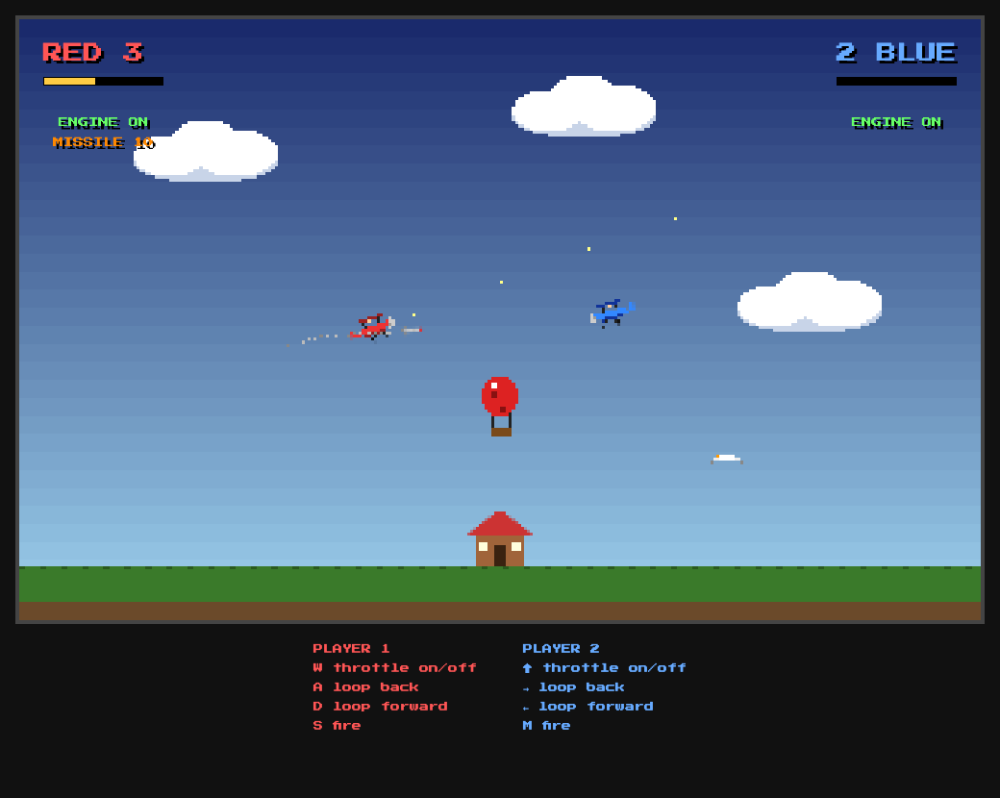

# Bip

A two-player biplane dogfight for the browser. It's a remake of *Biplane Duel* (a.k.a. "Bip") on the Amiga, which was based on *Biplanes* from the Intellivision *Triple Action* cartridge.

## Play

**[Play it online](https://jaybizzle.github.io/bip/)**, or open `index.html` in a browser. Press **Space** to start. There's no build step and nothing to install.

## Controls

| | Throttle (on/off) | Loop back | Loop forward | Fire |
|---|---|---|---|---|
| **Player 1** (red) | W | A | D | S |
| **Player 2** (blue) | ↑ | → | ← | M |

## Rules

- Shoot the other plane down to score. First to 10 wins.
- Hitting the ground or the hut kills you, and your opponent gets the point.
- Fly off one side of the screen and you come back on the other.
- Climb too steeply or let your speed drop and you'll **stall**. The engine coughs and the wings wobble as a warning. Dive to recover.
- Planes on the runway can't fire and can't be hit.
- Your gun **overheats** if you hold fire too long, and jams until it cools.
- When you're shot down your pilot **bails out**. Once the parachute opens, the other player can shoot the pilot (or fly through the chute) for a bonus point.
- Mid-air collisions destroy both planes and score nothing.

## Power-ups

- **Balloon**: it takes 5 hits. The player who pops it gets 3 seconds of **rapid fire** with no overheating. It comes back at a random time and place.
- **Seagull**: shoot it and it squawks and launches a **guided missile** at your opponent. The missile turns slower than a plane, so a tight loop can shake it. It can be shot down, it runs out of fuel after 10 seconds, and it dives into the ground if its target goes down.

## Tuning

All the gameplay numbers (speeds, stall, turn rate, heat, power-up timings) are constants at the top of the script in `index.html`.
